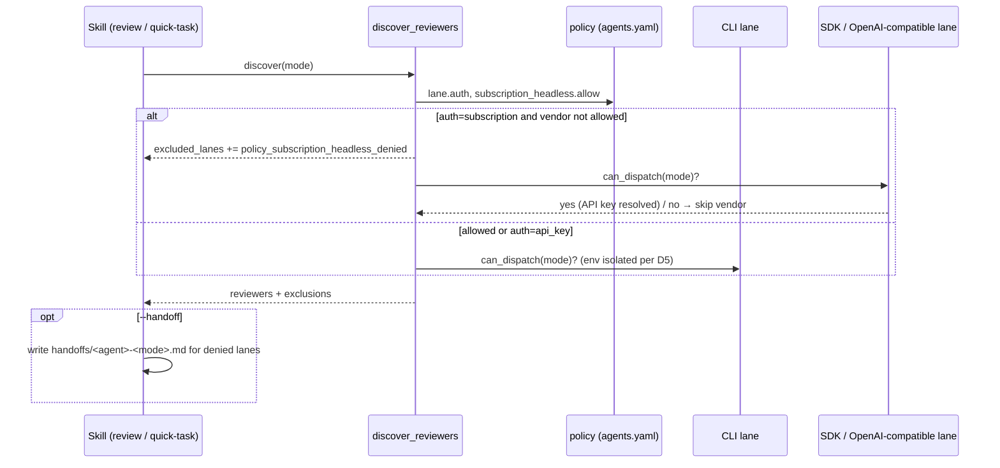

# Design: add-headless-auth-policy

## Context

`discover_reviewers` deduplicates by vendor and picks the first available tier:
CLI (transport `mcp`), SDK, OpenAI-compatible, skip. `vendor_subprocess_env` passes a
vendor CLI every variable with the vendor's prefix (`ANTHROPIC_`, `OPENAI_`, `GEMINI_`,
`GOOGLE_`, `XAI_`), so whether a CLI run bills the subscription or the API depends on
what happens to be exported. Nothing records which was used.

Current lanes and the credential they use today:

| Lane | Route | Credential |
|---|---|---|
| `claude-local` | `claude --print` | subscription login |
| `claude-remote` | `anthropic` SDK | `ANTHROPIC_API_KEY` |
| `codex-local` | `codex exec` | subscription login |
| `codex-remote` | `openai` SDK | `OPENAI_API_KEY` |
| `antigravity-local` | `agy --prompt` | subscription login |
| `grok-local` | `grok --prompt-file` | subscription login |
| `pi-local` | `pi -p --provider openrouter` | `OPENROUTER_API_KEY` |
| `ocr-local` | `ocr_adapter.py` | its own LLM endpoint config |

## Source of the vendor reading (unverified)

The per-vendor table in `proposal.md` comes from a single LLM-generated summary the
maintainer supplied on 2026-11-20. Its citations were opaque redirect links and were
not followed. Task 1.1 replaces it with a reading of the primary terms, with URLs and
dates, before any vendor is placed on the allow list. If a vendor's terms turn out to
permit the pattern, the fix is a one-line policy edit, not a code change.

## Decisions

### D1 — Separate the fact (lane credential) from the policy (where it is allowed)

`cli.auth` states what credential a lane uses. `policies.subscription_headless.allow`
states for which vendors unattended subscription use is acceptable. The gate is
derived: a lane is denied when `auth == subscription` and its `policy_vendor` is not
allowed.

*Alternative: one per-lane field `headless_auth: subscription | api_key | never`.*
Rejected. It mixes a fact with a judgement, and a new lane copied from an existing one
would inherit "allowed" silently. With D1 a new subscription lane is denied until
someone adds its vendor to the allow list with a stated basis.

*Alternative: hard-code the vendor list in the dispatcher.* Rejected; the reading of
terms changes more often than the code should.

### D2 — Fail closed everywhere

- `auth` is required on every `cli` block; `agents_config.validate` rejects a missing
  value.
- A dispatch payload without `auth` (older coordinator) is treated as `subscription`.
- A missing `policies.subscription_headless` block means an empty allow list.
- No environment variable or CLI flag overrides the gate.

*Alternative: `AGENTIC_ALLOW_SUBSCRIPTION_HEADLESS=1` escape hatch.* Rejected. The
failure being prevented is an account suspension; an override that an agent can set in
its own shell defeats the point.

### D3 — Allow entries carry their justification

```yaml
policies:
  subscription_headless:
    allow:
      - vendor: codex
        basis: "<one line, with the URL of the term relied on>"
        reviewed: 2026-11-20
      - vendor: grok
        basis: "<...>"
        reviewed: 2026-11-20
    review_after_days: 180
```

`vendor-status` warns when `reviewed` is older than `review_after_days`. It is a
warning, not a denial: terms going stale should prompt a re-read, not break dispatch
mid-run.

### D4 — Tier order stays; the gate is a filter in front of tier 1

Reordering tiers globally (SDK before CLI) would also demote `codex`, `grok` and `pi`,
whose CLI lanes are agentic (they read the worktree) while the SDK lanes only see the
review packet. Instead the gate removes a denied CLI lane before tier selection and
records it in `last_exclusions` and the manifest's `excluded_lanes` with reason
`policy_subscription_headless_denied`. The existing fall-through to SDK and
OpenAI-compatible lanes then applies unchanged.

The policy exclusion is not written to the probe cache. It is a configuration fact,
recomputed on every discovery, and must not expire after a TTL.

### D5 — Credential isolation in the subprocess environment

| Lane `auth` | Vendor API-key variables | Declared `api_key_env` |
|---|---|---|
| `subscription` | removed (`ANTHROPIC_API_KEY`, `ANTHROPIC_AUTH_TOKEN`, `OPENAI_API_KEY`, `GEMINI_API_KEY`, `GOOGLE_API_KEY`, `XAI_API_KEY`) | n/a |
| `api_key` | only the declared one passes | required; `can_dispatch` false without it |
| `none` | unchanged | unchanged |

`REVIEW_DISPATCH_ENV_PASSTHROUGH` cannot re-add a removed key name for a
`subscription` lane.

### D6 — Metered replacements for denied vendors

- **Claude:** `claude-remote`'s `anthropic` SDK lane already exists and becomes the
  selected route. An agentic alternative, `claude --print` with `auth: api_key`, is
  added only if task 4.3 shows by observation that the CLI authenticates with the key
  when a stored login is also present. This follows the repository's practice of
  recording CLI behaviour empirically before configuring it.
- **Gemini:** add `antigravity-remote` with an `sdk` block (`google` package;
  `_call_google` already exists) and add `google` to `credential_vendors`.
- **Either, via gateway:** `pi-local` and the OpenAI-compatible lanes can already run
  Claude and Gemini models through OpenRouter under the existing spend ceiling.
  Vendor deduplication counts these as vendor `pi`/`openrouter`, so they add capacity
  but not a distinct vendor for quorum; `openrouter-review-lane` addresses that.

### D7 — Manual handoff

`review_dispatcher.py --handoff` and `/quick-task --handoff` write, for each
policy-denied lane, `handoffs/<agent_id>-<mode>.md` containing the prompt and the
exact argv. The human runs it in their own terminal. The file states that results are
not ingested automatically. Handoffs never count toward quorum, so a round cannot be
made to pass by producing files.

*Alternative: detect a TTY and allow the denied CLI when a human is present.*
Rejected. The orchestrating agent, not the human, would still be the one spawning the
process, which is the pattern in question.

### D8 — Probe auth follows the lane's credential

For an `api_key` CLI lane, L2 is `auth_ok` when the declared variable is set and
`auth_failed` otherwise; the lane's `auth_status_args` are not run, because they
report on the stored subscription login. The variable's value is never read into
output.

## Sequence



## Risks

| Risk | Mitigation |
|---|---|
| Quorum drops where neither API keys nor Codex/Grok are available | `--check-vendors` already fails below quorum; the exclusion reason names the fix |
| Metered Claude/Gemini spend grows unnoticed | Depends on `add-model-usage-ledger`; SDK lanes are selected only when a key is provisioned |
| Codex or Grok terms change | `reviewed` date and staleness warning (D3); removal is a one-line edit |
| SDK reviewers see only the packet, not the worktree | Review packets already embed the diff and selected files; task 4.3 may add an agentic API-key lane |
| Collision with `openrouter-review-lane` in `discover_reviewers` | Land sequentially; the gate is a self-contained pre-filter |

## Migration

1. Add `auth` to all eight `cli` blocks and the policy block (allow list empty).
2. Land the gate. All subscription CLI lanes are now denied; SDK, pi and
   OpenAI-compatible lanes carry review.
3. After task 1.1, add `codex` and `grok` to the allow list with their basis.
4. Re-run `install.sh` so runtime skill copies in consumer repositories pick up the
   new dispatcher.

## Open Questions

1. Do coordinator work-queue workers that run as long-lived subscription CLI sessions
   need the same gate, or are they human-started sessions outside this policy?
2. Should a manually completed handoff be ingestible as a non-quorum advisory finding?
3. Is `codex` allowed on the strength of silence in the terms, or held to the same
   standard as an explicit permission?
